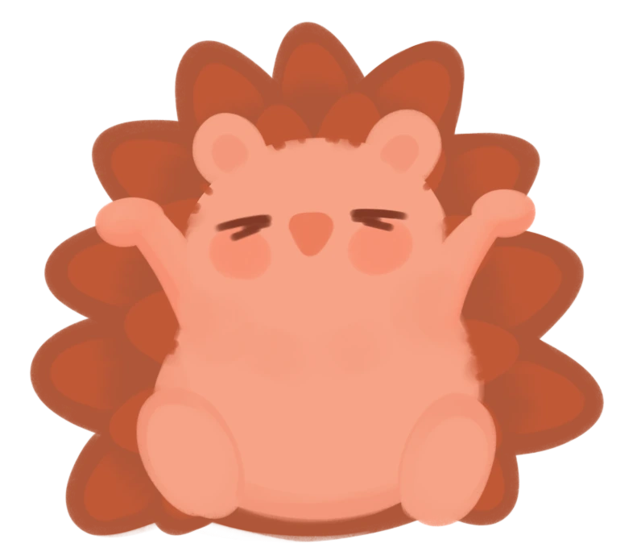
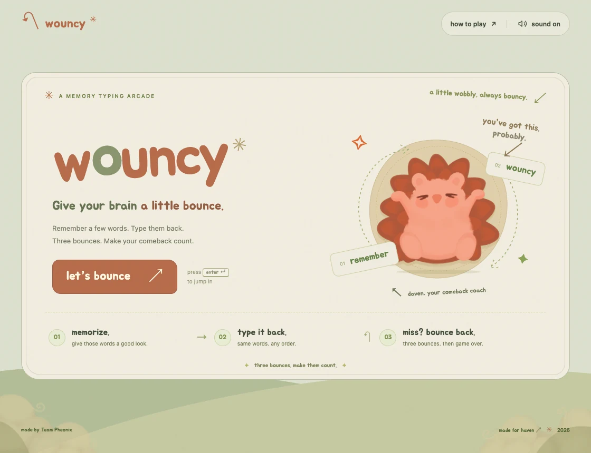
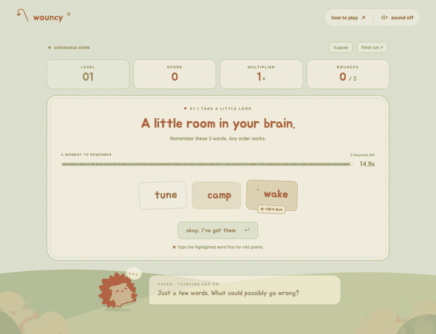
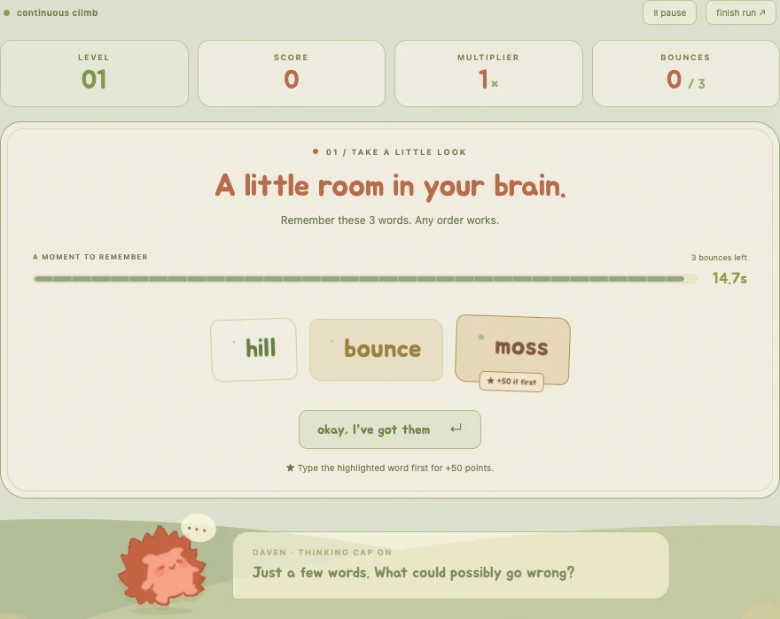
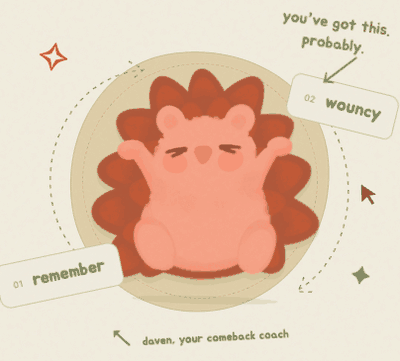
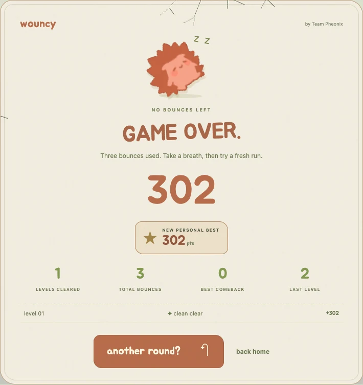

<div align="center">



# wouncy ✳

### a little wobbly. always bouncy.

A cozy memory typing game for a very busy little brain.<br>
Made with sage, clay, second chances, and one mildly sarcastic hedgehog.

**[let’s bounce ↓](#lets-bounce)** · **[meet daven ↓](#meet-daven)** · **[peek under the hood ↓](#under-the-hood)**

<sub>made by <strong>Team Pheonix</strong> for <a href="https://haven.hackclub.com">Hack Club Haven</a> · plays in your browser</sub>

<br>



</div>

<br>

## a tiny game. a surprisingly stubborn brain.

Some words show up. You give them a good look. They disappear.

Now it’s just you, your keyboard, and the very confident feeling that one of those words was definitely *mushroom*.

Type them back **in any order**. Miss one? Wouncy gives you a little breathing room and another try. Daven believes in you. Probably.

<div align="center">

<a href="#lets-bounce"></a>

<sub>a real little run: look → type → celebrate → wobble → try again. click the preview to get started.</sub>

</div>

## the comeback recipe

| a little moment | what happens |
| :--- | :--- |
| 🌱 **look** | Remember the words before the timer empties. You start with 15 seconds. |
| ⌨️ **type** | Enter each word once, in any order. Space or Enter locks it in. |
| ⭐ **a tiny extra** | Type the highlighted ★ word first for **+50 points** when you clear the level. |
| 🍃 **a little movement** | From level **4**, words bounce gently while you memorize; movement gets quicker every two levels, up to a cap. Turn **moving words** off on the home screen, or use your device’s reduced-motion setting. |
| ✨ **keep climbing** | Longer lists, trickier words, less time. Clean clears grow your multiplier up to **3×**. |
| ↶ **bounce back** | The same words return. The first miss adds **5 seconds**; the second adds **3**. |
| 🍂 **three’s the limit** | Your **third miss ends the run**. Bounces carry across levels. A fresh run starts fresh. |

A comeback deserves a little credit, too: clear a level after two bounces for a bonus. After a clear, take a breath—your next level waits until you’re ready.

<div align="center">



<sub>the golden word is your little side quest.</sub>

</div>

<a id="meet-daven"></a>

## meet daven

Part comeback coach. Part tiny distraction. Entirely invested in your success.

Move your mouse near Daven on the landing page: they’ll lean over, follow along, and get a little excited when you click. In a run, they think, type, celebrate, and take little breathers with you.

<div align="center">

<a href="#lets-bounce"></a>

<sub>yes, you can say hi. no, daven will not remember the words for you.</sub>

</div>

<details>
<summary><strong>a few more little things to love ✿</strong></summary>

- **A soundtrack for your tiny adventure.** Calm electronic music on the menu, a little more pulse in play, and a “BOUNCE BACK” chant when things go sideways.
- **A screen that tells a story.** Every miss adds cracks. The colors and audio get a little more scuffed with your bounce count.
- **A place for your personal best.** It stays in this browser when local storage is available.
- **A comeback worth sharing.** Game over can make a score screenshot. Save it, copy your score, or open a social draft. You choose what gets posted.
- **A little less motion, if you like.** Animations respect your reduced-motion preference. Daven has a quiet touch fallback, too.

</details>

<a id="lets-bounce"></a>

## let’s bounce

You’ll need **Node.js 20 or newer**, a browser, and a keyboard that has not yet heard you say “one more try.”

```sh
git clone https://github.com/amritkang165/Wouncy.git
cd Wouncy
npm run dev
```

Open **[localhost:4173](http://localhost:4173)**. That’s it—no build step or runtime dependency install. Keep the terminal open while you play; **Ctrl+C** stops the server.

The game fits the available viewport without page scrolling, including the game-over sharing controls. Compact layouts adapt to phones, landscape play, and the space above a mobile keyboard.

| your little keyboard | its little job |
| :--- | :--- |
| **Enter** | Start a run, hide the words when you’re ready, or move to the next level. |
| **Space / Enter** while typing | Lock in a word. Case doesn’t matter. |
| **Backspace** | Rescue a typo before you submit it. |
| **Escape** | Pause or resume. Opening instructions or leaving the tab also pauses an active timer. |
| **Sound button** | Toggle audio for this visit. Leaving the tab stops audio; pause and instructions keep the music playing. |

<details>
<summary><strong>landed on “game over”? there’s a fresh start waiting.</strong></summary>

Your score, last level, cleared levels, and bounce count stay on the results screen. A new personal best saves automatically. Use **another round?** for a new run, or save a little souvenir first.

<div align="center">



</div>

The GIFs above are looping recordings of the game. Open Wouncy locally to move the mouse, type the words, and make your own comeback.

</details>

<a id="under-the-hood"></a>

## under the hood

Small enough for a jam. A few plain browser files doing their little jobs.

| little home | what lives there |
| :--- | :--- |
| [`dist/config.js`](dist/config.js) | Timing, difficulty, score bonuses, and the three-bounce limit. |
| [`dist/engine.js`](dist/engine.js) | The game’s rules, state machine, and word pools. |
| [`dist/app.js`](dist/app.js) | Screens, keyboard input, and the game loop. |
| [`dist/style.css`](dist/style.css) | All that matte paper, sage, and clay. |
| [`dist/viewport.css`](dist/viewport.css) · [`dist/viewport.js`](dist/viewport.js) | Compact layouts and viewport fitting, including mobile keyboard changes. |
| [`dist/companion.js`](dist/companion.js) | Daven’s mouse-following curiosity. |
| [`dist/audio.js`](dist/audio.js) · [`dist/damage.js`](dist/damage.js) | Music, sound cues, and the cracks in your comeback story. |
| [`dist/sharing.js`](dist/sharing.js) | Score text, local PNG screenshots, and sharing controls. |

To tinker and check things:

```sh
npm install
npm test
```

For browser checks, keep `npm run dev` running in one terminal and run this in another:

```sh
npm run test:browser
```

Browser checks use Playwright with an installed **Google Chrome**. The playable files live in `dist/`; that folder can be served by a static web host.

<details>
<summary><strong>developer crumbs: scoring, sharing, and contributions</strong></summary>

**Scoring:** WPM × accuracy (0–1) × streak multiplier, plus earned bonuses. Each clean clear raises the multiplier by 0.5×, capped at 3×. The starred-word-first bonus is 50 points; a clear after two bounces adds 100 points per bounce. Personal bests use the current scoring record, separate from early prototype scores.

**Sharing:** The game bundles an MIT-licensed html-to-image helper. Social buttons open drafts and save the screenshot for attaching; compatible devices can offer native image sharing. Nothing is posted automatically. For an itch.io iframe, set `PUBLIC_GAME_URL` in [`dist/sharing.js`](dist/sharing.js) to the public game page when one is available.

**Contributing:** One descriptive commit per requested edit. Run the relevant checks, keep unrelated changes out, and push the completed commit. See [`AGENTS.md`](AGENTS.md).

</details>

## a little thank-you garden

Wouncy is made by **Team Pheonix** for the Haven game jam. Its cozy little world has some lovely roots:

- **Daven and the scenery:** original [Hack Club Haven](https://haven.hackclub.com) artwork, including the owner-supplied character image. The character images are unchanged; CSS adds their motion and props. No AI image generation was used. Confirm permission to reuse Haven art before distributing a submission.
- **Music:** [“Singularity” by vitalezzz](https://opengameart.org/content/singularity-0), CC0. The menu uses the calm version; play blends calm and action.
- **Sound effects:** [Kenney UI Audio](https://kenney.nl/assets/ui-audio) and [Music Jingles](https://kenney.nl/assets/music-jingles), CC0. The short “BOUNCE BACK” chant is bundled separately.
- **Type:** Jua by Woowahan Brothers, under the [SIL Open Font License](dist/assets/OFL.txt).
- **Score screenshots:** the bundled [html-to-image helper](dist/vendor/html-to-image-LICENSE.txt), MIT.

Exact asset sources, conversions, and license files are in [`dist/assets/CREDITS.txt`](dist/assets/CREDITS.txt). The chant was synthesized with the macOS Eddy voice. Wouncy is an independent game, not an official Hack Club product.

<div align="center">

<br>


**small brain. big comeback.**

<sub>see you on the next bounce. ♡</sub>

</div>
